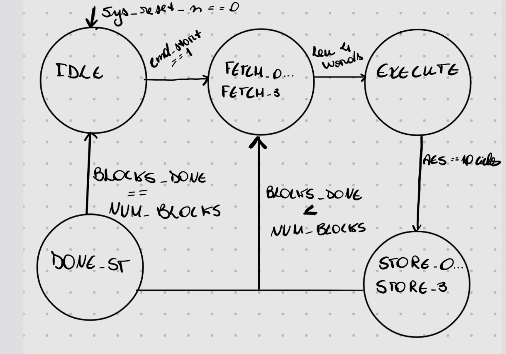

# Especificação de Microarquitetura v1.0 — MiniSoC AES


## 1. Visão Geral e Arquitetura do Sistema

O **MiniSoC AES** é um sistema digital integrado para processamento criptográfico AES-128 em múltiplos modos de operação (ECB, CBC, PCBC, CFB, OFB e CTR). O sistema integra:

1. **Front-End SPI (minisoc_spi):** Interface de controle/status operando no domínio de clock **spi_sclk** (até 25 MHz) com sincronização para o domínio do sistema.

2. **Banco de Registradores:** Armazena configurações (KEY0..3, IV0..3, COUNTER_HI/LO,  NUM_BLOCKS ,  AES_CONTROL ,  SYSTEM_CONTROL ).

3. **PLL Mock ( minisoc_pll_mock ):** Recebe referência de 2 GHz ( clk ) e gera o clock do sistema  sys_clk  com divisores programáveis (/1, /2, /4, /8) e controle de *lock*.

4. **Memória Compartilhada ( minisoc_memory ):** RAM *single-port* de $1024 \times 32$ bits (capacidade para até 256 blocos AES de 128 bits), com arbitragem por multiplexador de *ownership* ( MEM_SEL_AES ).

5. **AES Engine ( minisoc_aes_top ):** Controlador FSM e datapath criptográfico de 128 bits operando no domínio  sys_clk .

---

## 2. Diagrama de Blocos Interno e Mapeamento de Módulos

### 2.1 Diagrama de Interconexão Geral


   
### **Especificação Detalhada de Sinais por Interface**

#### **A. Sinais Externos de Topo (DUT Pins)**

Estes são os pinos que conectam o  minisoc_top com o externo:

* **Interface de Clock & Reset:**
*  clk  ( input , **1 bit**): Clock de referência de 2 GHz vindo do oscilador de cristal.


*  rst_n  ( input , **1 bit**): Reset global assíncrono do chip (ativo em nível baixo  0 ).


* **Interface SPI ( SPI IF  - até 25 MHz):**
*  spi_sclk  ( input , **1 bit**): Clock da comunicação serial SPI.


*  spi_cs_n  ( input , **1 bit**): Chip Select da SPI (ativo em nível baixo  0 ).


*  spi_mosi  ( input , **1 bit**): Dados seriais de entrada (Master Output / Slave Input).


*  spi_miso  ( output , **1 bit**): Dados seriais de saída (Master Input / Slave Output).


* **Interface Externa de Memória ( MEMORY DATA IF ):**
*  mem_clk  ( input , **1 bit**): Clock do usuário externo para acesso à SRAM (até 200 MHz).


*  mem_i_addr  ( input , **10 bits**): Endereço de palavra ($0$ a $1023$) fornecido pelo usuário.


*  mem_i_data  ( input , **32 bits**): Dado enviado pelo usuário para escrita na memória.


*  mem_i_wr_en  ( input , **1 bit**): Sinal de escrita do usuário ( 1  = Escrita,  0  = Leitura).


*  mem_o_data  ( output , **32 bits**): Dado retornado pela SRAM em operações de leitura.


---

#### **B. Conexões Internas Entre Módulos**

##### **1. Gerador de Clock ( minisoc_pll_mock )**

* **Recebe do SPI:**
*  pll_enable  ( input , **1 bit**): Habilita/desliga a síntese de clock do PLL.


*  pll_div_sel  ( input , **2 bits**): Seleciona a divisão de frequência ( 00 =/1: 2GHz,  01 =/2: 1GHz,  10 =/4: 500MHz,  11 =/8: 250MHz).


* **Envia para o SPI:**
*  pll_locked  ( output , **1 bit**): Flag informando que a frequência estabilizou.


* **Saída de Clock:**
*  sys_clk  ( output , **1 bit**): Clock gerado pelo PLL para acionar o AES e a SRAM.


##### **2. Controle e Status ( SPI  $\leftrightarrow$  AES Engine )**

Barramento de controle no domínio de clock  sys_clk :

* **Sinais do SPI para o AES ( cfg_\*  e  cmd_\* ):**
*  cfg_key  ( output  do SPI /  input  no AES, **128 bits**): Chave AES de 128 bits concatenada ( KEY0..KEY3 ).


*  cfg_iv  ( output  do SPI /  input  no AES, **128 bits**): Vetor de Inicialização ( IV0..IV3 ).


*  cfg_counter  ( output  do SPI /  input  no AES, **64 bits**): Contador inicial do modo CTR ( COUNTER_HI/LO ).


*  cfg_num_blocks  ( output  do SPI /  input  no AES, **9 bits**): Número de blocos a processar ($1$ a $256$).


*  cfg_mode  ( output  do SPI /  input  no AES, **3 bits**): Modo de operação (ECB, CBC, PCBC, CFB, OFB, CTR).


*  cfg_decrypt  ( output  do SPI /  input  no AES, **1 bit**):  0  para Cifragem,  1  para Decriptação.


*  cmd_start  ( output  do SPI /  input  no AES, **1 bit**): Pulso de gatilho para a FSM iniciar.


* **Sinais do AES para o SPI ( status_* ):**
*  status_busy  ( input  no SPI /  output  do AES, **1 bit**): Indica que a FSM está operando.


*  status_done  ( input  no SPI /  output  do AES, **1 bit**): Flag *sticky* de término.


*  status_error  ( input  no SPI /  output  do AES, **1 bit**): Flag de erro de configuração.


*  status_blocks_done  ( input  no SPI /  output  do AES, **9 bits**): Progresso dos blocos concluídos.


##### **3. Arbitragem e Conexão de Memória ( AES  /  User  $\rightarrow$  Mem Mux  $\rightarrow$  SRAM )**

* **Sinal de Arbitragem:**
*  MEM_SEL_AES  ( output  do SPI para o Mux, **1 bit**):  0  seleciona o canal do usuário externo ( mem_ext_* );  1  seleciona o canal do  AES Engine  ( aes_mem_* ).


* **Canal 0: Interface Externa do Usuário (conectada ao Mux se  MEM_SEL_AES = 0 ):**
*  mem_ext_addr  (**10 bits**): Conectado diretamente ao pino de entrada  mem_i_addr .


*  mem_ext_wdata  (**32 bits**): Conectado diretamente ao pino de entrada  mem_i_data .


*  mem_ext_wr_en  (**1 bit**): Conectado ao pino de entrada  mem_i_wr_en .


*  mem_ext_clk  (**1 bit**): Conectado ao pino de entrada  mem_clk .


* **Canal 1: Interface do AES Engine (conectada ao Mux se  MEM_SEL_AES = 1 ):**
*  aes_mem_addr  ( output  do AES para o Mux, **10 bits**): Endereço gerado pela FSM do AES.


*  aes_mem_wdata  ( output  do AES para o Mux, **32 bits**): Palavra processada *in-place*.


*  aes_mem_wr_en  ( output  do AES para o Mux, **1 bit**): Sinal de escrita da FSM do AES.


*  sys_clk  (**1 bit**): Clock de sistema proveniente do PLL.


* **Retorno da Leitura da SRAM (Mux para Destino):**
*  mem_aes_rdata  ( input  no AES vindo do Mux, **32 bits**): Palavra lida da memória para o AES quando  MEM_SEL_AES = 1 .


*  mem_o_data  ( output  do Chip vindo do Mux, **32 bits**): Palavra lida para a interface do usuário quando  MEM_SEL_AES = 0 .

---

## 3. Microarquitetura do AES (Datapath e Modos)

### 3.1 Escolha da Abordagem do Datapath

Adotou-se a **arquitetura iterativa com 1 rodada por ciclo de clock** para o datapath do AES-128 (minisoc_aes_dp).

* **Justificativa:**
* **Balanceamento de Área e Desempenho:** Arquiteturas totalmente desenroladas (*fully unrolled*) exigem 10 cópias completas do datapath (consumindo elevadíssima área de silício), enquanto abordagens de sub-palavra de 32 bits exigem muitos ciclos extras. A arquitetura de 1 rodada por ciclo processa um bloco de 128 bits em exatamente 10 ciclos de clock de processamento ativo.
* **Alinhamento com a Memória Single-Port:** Como a leitura do bloco de 128 bits exige 4 acessos de 32 bits à SRAM (4 ciclos de clock), o gargalo de largura de banda da memória torna o datapath de 1 rodada/ciclo ideal e sem desperdício de throughput.


### 3.2 Modos de Operação (ECB, CBC, PCBC, CFB, OFB, CTR)

O datapath inclui registradores de encadeamento (*chaining*) que armazenam o vetor $IV$ ou o bloco de ciphertext/plaintext anterior entre os processamentos de bloco:

1. **ECB (Electronic Codebook):** Processamento independente de cada bloco direto pelo datapath.


2. **CBC (Cipher Block Chaining):**
* *Cifragem:* O plaintext é somado via XOR com o estado acumulado ($IV$ no 1º bloco, Ciphertext no bloco posterior) antes da cifragem.


* *Decriptação:* O ciphertext passa pela decriptação inversa e o resultado sofre XOR com o estado acumulado ($IV$ ou Ciphertext anterior).


3. **PCBC (Propagating Cipher Block Chaining):**
* O vetor de encadeamento é atualizado pela operação $(P_{n-1} \oplus C_{n-1})$, que é combinada via XOR com o bloco atual antes da cifragem ou após a decriptação.


4. **CFB, OFB e CTR (Modos de Fluxo / Stream):**
* Nestes modos, o motor AES executa **apenas a cifragem direta** (mesmo na decriptação).
* **CTR:** O valor [IV[127:64], COUNTER[63:0]] é incrementado a cada bloco, cifrado pelo AES, e sofre XOR com o dado da memória.
* **OFB/CFB:** O bloco de feedback ($IV$ ou cifrado anterior) é cifrado no datapath e somado via XOR ao dado lido da memória.


---

## 4. FSM de Controle (minisoc_aes_top)

A FSM do **minisoc_aes_top**  opera no domínio **sys_clk** e orquestra a leitura serial de 4 palavras de 32 bits da SRAM, o processamento de 128 bits no datapath e a reescrita *in-place*.

### 4.1 Mapeamento de Estados da FSM





1. **ST_IDLE:**
* Aguarda cmd_start = 1 vindo do SPI.


* Valida parâmetros (NUM_BLOCKS entre $1$ e $256$). Se inválido, vai para erro (status_error = 1).


* Zera o contador interno BLOCKS_DONE e ajusta a base de endereço base_addr = 0.


2. **ST_FETCH_0 a ST_FETCH_3:**
* Emite aes_mem_wr_en = 0 e lê sequencialmente os endereços base_addr + 0 a base_addr + 3.


* Monta o registrador de estado de 128 bits: state_in = {word0, word1, word2, word3}.


3. **ST_EXECUTE:**
* Habilita o datapath iterativo minisoc_aes_dp.


* Decrementa a contagem de rodadas de $10$ até $0$ (consumindo 10 ciclos de clock).
* Aplica as transformações diretas ou inversas conforme o modo configurado.


4. **ST_STORE_0 a ST_STORE_3:**
* Emite aes_mem_wr_en = 1 e grava o resultado de 128 bits (state_out) em 4 palavras de 32 bits nos endereços base_addr + 0 a base_addr + 3 (*in-place*).


5. **ST_NEXT_BLOCK:**
* Incrementa BLOCKS_DONE e avança o ponteiro de memória (base_addr <= base_addr + 4).


* Se BLOCKS_DONE < NUM_BLOCKS, avança para ST_FETCH_0; caso contrário, vai para ST_DONE.


6. **ST_DONE:**
* Eleva status_done = 1 (*sticky*) e desassere status_busy = 0.


* Retorna para ST_IDLE ao receber a limpeza de flag ou novo comando.


---

## 5. Estratégia de CDC (Clock Domain Crossing)

O sistema possui dois domínios de clock independentes na comunicação serial: spi_sclk (até 25 MHz) e clk (always-on 2 GHz).

### 5.1 Mecanismo de Sincronização por Toggle

Para evitar perda de pulso em travessia de domínios sem o uso de FIFOs assíncronas complexas, implementou-se o protocolo de **sincronização por alternância de nível (*Toggle-based Event Synchronization*)**:

```
Domínio spi_sclk :   [ Frame Completo 40 bits ] ---> (Toggle Register: spi_toggle <= ~spi_toggle)
                                                              |
                                                              v
Domínio clk      :   [ 2-FF Synchronizer ] ---> (Edge Detector: pulse = sync_q2 ^ sync_q3)
```


1. **Lógica no Domínio spi_sclk:**
* Ao finalizar a recepção serial de um frame de 40 bits (com a subida de spi_cs_n), o pino de estado inverte o registrador toggle: spi_frame_toggle <= ~spi_frame_toggle.


2. **Sincronizador no Domínio clk (Always-On):**
* O sinal spi_frame_toggle passa por um sincronizador de 2 FFs cascateados (q1 e q2) no domínio clk para eliminar chances de metaestabilidade.


3. **Detector de Borda no Domínio clk:**
* Um registrador adicional captura o estado anterior (q3).
* A detecção da borda de alteração é obtida via XOR: valid_frame_pulse = sync_q2 ^ sync_q3.
* Esse pulso de 1 ciclo em clk habilita a escrita segura dos dados do frame no banco de registradores internos.


---

## 6. Sequência de Reset e Inicialização Determinística

Conforme a Seção 4.2 do Block Guide, o domínio do sistema sys_clk depende da liberação do PLL e permanece bloqueado no início.

### 6.1 Fluxo Determinístico de Reset

              
**GLOBAL RESET**                                                          
1. quando (rst_n=0) 
 
2. haverá Reset Assíncrono do Banco SPI e PLL                       
                                              
3. Então, SPI Configura PLL_ENABLE=1 no registrador SYSTEM_CONTROL  
                  
4. Daí: PLL Oscila, Estabiliza e Eleva PLL_LOCKED = 1   => (Libera a distribuição do sys_clk)                     
             
5. Por fim: Reset Synchronizer aguarda 4 ciclos válidos de sys_clk e desassere sys_rst_n = 1 de forma síncrona                

---

1. **Aplicação do Reset Global:** O sinal pino rst_n = 0 força o reset assíncrono do bloco de registradores do SPI e zera o estado do PLL mock.


2. **Bloqueio do Domínio do Sistema:** Enquanto pll_locked = 0, a linha sys_clk fica desativada e o sinal de reset interno sys_rst_n do AES Engine é mantido ativo em nível baixo (0).


3. **Ativação e Liberação do PLL:** O software grava PLL_ENABLE = 1 via SPI. O modelo PLL atinge o *lock*, eleva pll_locked = 1 e libera os pulsos do sys_clk.


4. **Desasserimento Síncrono (sys_rst_n):** Um **Reset Synchronizer** (duas etapas de FFs alimentadas por sys_clk e com o pino rst_n conectado ao reset assíncrono do FF) garante que o desasserimento do reset no AES ocorra de forma perfeitamente síncrona com a borda de subida do sys_clk após 4 ciclos estáveis, prevenindo cenários de *recovery/removal violation* no arranque da FSM.


---

## 7. Mapeamento de Arquivos RTL do Projeto

| Nome do Módulo | Caminho do Arquivo RTL | Função Principal |
| --- | --- | --- |
| minisoc_top | rtl/minisoc_top.sv | Integração de topo do sistema e roteamento do multiplexador. |
| minisoc_spi | rtl/minisoc_spi/minisoc_spi.sv | Front-end SPI, CDC de toggle e banco de registradores.
| minisoc_pll_mock | rtl/minisoc_pll/minisoc_pll_mock.sv | Modelo RTL gerador e divisor de clock.
| minisoc_memory | rtl/minisoc_mem/minisoc_memory.sv | SRAM compartilhada $1024 \times 32$ bits.
| minisoc_aes_top | rtl/minisoc_aes/minisoc_aes_top.sv | Controlador FSM de acesso em blocos à memória.
| minisoc_aes_dp | rtl/minisoc_aes/minisoc_aes_dp.sv | Datapath iterativo do AES (1 rodada/ciclo).
| minisoc_aes_key_exp | rtl/minisoc_aes/minisoc_aes_key_exp.sv | Expansão dinâmica da chave de 128 bits.
