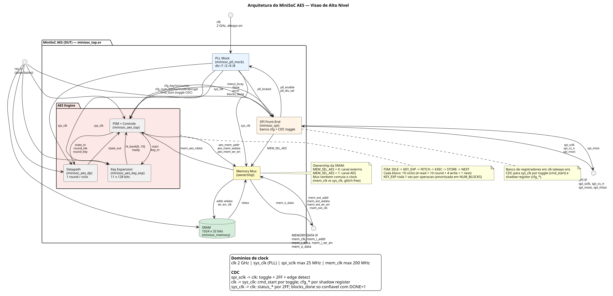
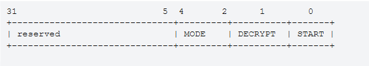
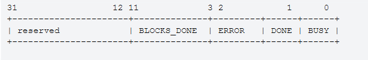
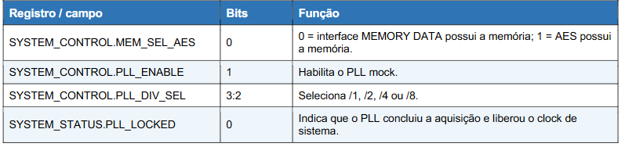
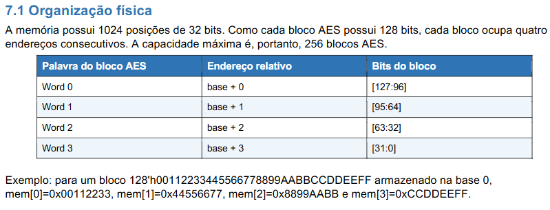
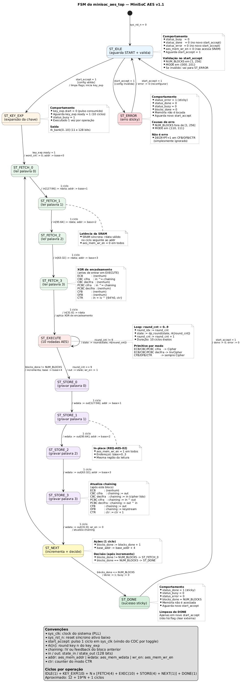

# Especificação de Microarquitetura v1.1 — MiniSoC AES

**Revisão da v1.0** com correções e **detalhamento completo do módulo de expansão de chave** (minisoc_aes_key_exp), sem uso da memória compartilhada.

---

## 0. Arquitetura do Sistema 




### 1. Pinos externos (4 grupos, conforme Block Guide §3)

| Grupo | Sinais | Descrição |
|---|---|---|
| **CLK** | clk (1 bit, 2 GHz) | Referência do oscilador; alimenta PLL e o domínio *always-on* (SPI + banco de registradores) |
| **RESET** | rst_n (1 bit, ativo baixo) | Reset global assíncrono; **não apaga a memória** (§7.3) |
| **SPI IF** | spi_sclk, spi_cs_n, spi_mosi, spi_miso | Mode 0, MSB-first, ≤25 MHz; frame de 40 bits (§5) |
| **MEMORY DATA IF** | mem_clk, mem_i_addr[9:0], mem_i_data[31:0], mem_i_wr_en, mem_o_data[31:0] | Canal externo de acesso à SRAM quando MEM_SEL_AES=0 |

**Ponto de atenção**: mem_clk é um clock **independente** (até 200 MHz), usado apenas pelo canal externo. Quando o AES tem a posse, o mux comuta para sys_clk (glitch-free, 7.2).

### 2. PLL Mock (minisoc_pll_mock)

| Sinal | Direção | Domínio | Função |
|---|---|---|---|
| clk | entrada | — | Referência 2 GHz |
| pll_enable | entrada | clk | Habilita síntese |
| pll_div_sel[1:0] | entrada | clk | Seleciona divisão (/1, /2, /4, /8) |
| pll_locked | saída | clk | Frequência estabilizada |
| sys_clk | saída | — | Distribuído para AES, DP, KeyExp e Mux |

**Regra**: o SPI não depende de sys_clk. Só depois de pll_locked=1 o domínio do AES é liberado (reset synchronizer, §3).

### 3. SPI Front-End (minisoc_spi)

- **Banco de registradores**: KEY0..3, IV0..3, COUNTER_HI/LO, NUM_BLOCKS, AES_CONTROL, SYSTEM_CONTROL, VERSION — todos em clk (6).

- **Saídas para o AES**: cfg_key[127:0], cfg_iv[127:0], cfg_counter[63:0], cfg_num_blocks[8:0], cfg_mode[2:0], cfg_decrypt, cmd_start.
- **Entradas do AES**: status_busy, status_done, status_error, status_blocks_done[8:0].
- **Travessia de domínio** (§4.2): cmd_start → toggle → 2FF → detector de borda → start_accept em sys_clk. Os cfg_* são capturados em *shadow register* no mesmo ciclo de start_accept (quasi-estáticos, §4.1).
- **Controle da memória**: MEM_SEL_AES (§6.3).

### 4. AES Engine (minisoc_aes_top + minisoc_aes_dp + minisoc_aes_key_exp)

| Módulo | Função | Sinais-chave |
|---|---|---|
| **minisoc_aes_top** | FSM de 8 estados (§9) | Consome start_accept, sh_*, mem_aes_rdata, key_exp.ready; produz aes_mem_*, status_*, key_exp.start |
| **minisoc_aes_dp** | 10 rodadas de AES-128, 1 rodada/ciclo | state_in[127:0], round_idx, round_key[127:0] → state_out[127:0] |
| **minisoc_aes_key_exp** | Expansão em rk_bank[0..10] (10) | start, key_in[127:0] → rk_bank[0..10], ready |

**Fluxo operacional** (§9.1): IDLE → KEY_EXP → [FETCH → EXEC → STORE → NEXT] × N → DONE. Cada bloco custa 19 ciclos; a expansão (10 ciclos) é amortizada em NUM_BLOCKS.

### 5. Memory Mux

- **Entrada de controle**: MEM_SEL_AES (vem do SPI).
- **Canal 0 (externo)**: mem_ext_* (conectado diretamente a mem_i_*).
- **Canal 1 (AES)**: aes_mem_* (conectado ao minisoc_aes_top).
- **Saída**: barramento unificado (addr, wdata, wr_en, clk) para a SRAM.
- **Retorno**: rdata da SRAM → mux → mem_aes_rdata (para o AES) ou mem_o_data (para o canal externo).
- **Comutação de clock**: mem_clk ↔ sys_clk deve ser *glitch-free* (§7.2).

### 6. Memória (minisoc_memory)

- **Capacidade**: 1024 × 32 bits = 256 blocos AES de 128 bits (§7.1).
- **Single-port, síncrona**: latência de 1 ciclo por leitura/escrita.
- **Sem reset funcional**: conteúdo inicial indeterminado (§7.3).
- **Mapeamento de bloco**: mem[base+0] é a palavra mais significativa (state_in[127:96]), mem[base+3] é a menos significativa.


## 1. Resumo das Mudanças

| Item | v1.0 | v1.1 |
|---|---|---|
| CDC clk ↔ sys_clk para cmd_start, cfg_* e status_* | Não especificado | **Novo** — handshake por toggle + captura estável |
| CTR | [IV[127:64], COUNTER] | **IV XOR {64'h0, COUNTER}** conforme guia |
| OFB | “feedback = cifrado anterior” | **feedback = saída do AES (keystream)** |
| Contagem de rodadas no EXECUTE | “10 até 0” | **10 ciclos (round = 0..9)** |
| Validação de MODE | Ausente | **MODE ∈ {000..101}, senão ERROR** |
| Semântica DONE/ERROR | “limpeza de flag” | **DONE sticky, limpo em novo START válido; ERROR sticky até novo START** (9) |
| SPI: protocolo, frame, mapa de registradores | Parcial | **6 e 7 completos** |
| Memória: reset, ownership, latência | Implícito | **7 expandido** |
| Key Expansion | Ausente | **10 — arquitetura completa** |

---

## 2. Visão Geral e Diagrama de Blocos

A arquitetura do MiniSoC AES permanece inalterada no topo: minisoc_top.sv integra PLL mock, SPI front-end, AES engine, memória compartilhada e mux de ownership. O detalhamento de pinos e módulos do documento v1.0 é integralmente mantido, salvo os ajustes listados no tópico 1.

---

## 3. PLL, Reset e Clock

Mantido da v1.0, com ênfase nas seguintes restrições:

- clk (2 GHz) alimenta o SPI e o **banco de registradores** (domínio *always-on*).
- sys_clk = f(clk, pll_div_sel) é liberado apenas quando pll_locked = 1.
- sys_rst_n é liberado de forma síncrona após **≥ 4 ciclos válidos de sys_clk** com um *reset synchronizer* de 2 FFs.
- O domínio clk **não depende** de sys_clk — regra de bootstrap do guia.

---

## 4. CDC — Correção da v1.0 → v1.1

A v1.0 especificava corretamente spi_sclk → clk (toggle), mas **não descrevia clk ↔ sys_clk**. Como o SPI escreve configuração e comando em clk e o AES consome em sys_clk, essa travessia é obrigatória.

### 4.1 Classificação dos sinais CDC

**Intuição**

É um pulso? → Preciso transformar em nível (toggle) para não perder. → Evento

É um nível de 1 bit? → Só preciso me proteger de metaestabilidade. → Nível

É um barramento que muda junto? → Preciso garantir que todos os bits sejam capturados no mesmo "instante" — e o "instante" é dado por um controle. → Quasi-estático

É um barramento que muda sozinho? → Não posso capturar a qualquer momento; preciso esperar a janela estável (ou codificar para tolerar mudanças). → Dinâmico


| Sinal | Direção | Tipo | Estratégia |
|---|---|---|---|
| cmd_start | clk → sys_clk | Evento (1 bit) | Toggle + sincronizador 2FF + detector de borda |
| cfg_key[127:0] | clk → sys_clk | Quasi-estático | Captura em *shadow register* no sys_clk na borda de cmd_start (após estabilização) |
| cfg_iv[127:0] | clk → sys_clk | Quasi-estático | Captura em *shadow register* no sys_clk na borda de cmd_start (após estabilização)  |
| cfg_counter[63:0] | clk → sys_clk | Quasi-estático | Captura em *shadow register* no sys_clk na borda de cmd_start (após estabilização)  |
| cfg_num_blocks[8:0] | clk → sys_clk | Quasi-estático | Captura em *shadow register* no sys_clk na borda de cmd_start (após estabilização)  |
| cfg_mode[2:0] | clk → sys_clk | Quasi-estático | Captura em *shadow register* no sys_clk na borda de cmd_start (após estabilização)  |
| cfg_decrypt | clk → sys_clk | Quasi-estático | Captura em *shadow register* no sys_clk na borda de cmd_start (após estabilização)  |
| status_busy | sys_clk → clk | Nível | Sincronizador 2FF |
| status_done | sys_clk → clk | Nível sticky | Sincronizador 2FF |
| status_error | sys_clk → clk | Nível sticky | Sincronizador 2FF |
| status_blocks_done[8:0] | sys_clk → clk | Multi-bit | **Não ler enquanto BUSY=1**; ler só quando DONE já estiver sincronizado em 1 (ver 4.3) |

### 4.2 Handshake de cmd_start

é o caminho completo que o comando START vai levar desde o domínio do SPI (clk always on) até o domínio AES (sys_clk), incluindo como os dados de configuração são transportados juntos sem corromper.


clk:        [START pulse] → set start_toggle

sys_clk:    start_sync_ff1 → start_sync_ff2 → start_sync_ff3 → start_edge = ff2 ^ ff3
            start_accept = start_edge
            On start_accept: capturar cfg_* em shadow regs; iniciar FSM


precisamos de 2 FFs para resolver a metaestabilidade (ff1, ff2) e mais um para guardar o valor anterior (ff3). A detecção de borda exige comparar "agora" com "antes".

**Justificativa:** o toggle transporta o evento sem depender da largura de pulso em clk. A captura simultânea dos cfg_* em um *shadow register* no sys_clk elimina a necessidade de sincronizar 128+ bits individualmente (que seria caro e sujeito a *incoerência de multi-bit*).

Pré-condição: cfg_* deve permanecer estável desde o penúltimo pulso de spi_sclk da transação de START até o start_accept. O SPI respeita essa condição naturalmente.

### 4.3 Semântica de status_blocks_done

Multi-bit CDC é intrinsecamente inseguro se o sinal muda enquanto é amostrado. Estratégia adotada para o MiniSoC:

- status_blocks_done **só é estável** quando BUSY = 0 e DONE já foi sincronizado em clk.

- Documentação do *Verification Plan*: a leitura de AES_STATUS deve aguardar DONE = 1 antes de interpretar BLOCKS_DONE (fluxo previsto no §9 do Block Guide).

- Para monitoramento *durante* a operação, o SPI pode ler BUSY e DONE, mas não deve usar BLOCKS_DONE como progresso em tempo real.

---

## 5. SPI Front-End

### 5.1 Protocolo

- SPI **Mode 0**: CPOL = 0, CPHA = 0.
- MSB-first.
- MOSI amostrado na **borda de subida** de spi_sclk.
- MISO atualizado na **borda de descida** de spi_sclk.
- spi_sclk ≤ 25 MHz.
- **Write**: 1 transação. **Read**: 2 transações (a primeira endereça, a segunda desloca o valor).

### 5.2 Frame de 40 bits

```
39       38:33     32       31:0
+--------+---------+--------+------------------+
| RWb    | ADDR    |  RSV   | DATA[31:0]       |
| 1 bit  | 6 bits  | 1 bit  | 32 bits          |
+--------+---------+--------+------------------+
```

- RWb = 0 → write; RWb = 1 → read request.
- RSV deve ser enviado como 0.
- Em read, DATA[31:0] é ignorado.
- Endereço 0x3F (NOP) é usado como fase de retorno da leitura.

---

## 6. Mapa de Registradores (Completo)

| Addr | Registro | Acesso | Descrição |
|---|---|---|---|
| 0x00 | KEY0 | R/W | cfg_key[127:96] |
| 0x01 | KEY1 | R/W | cfg_key[95:64] |
| 0x02 | KEY2 | R/W | cfg_key[63:32] |
| 0x03 | KEY3 | R/W | cfg_key[31:0] |
| 0x04 | IV0 | R/W | cfg_iv[127:96] |
| 0x05 | IV1 | R/W | cfg_iv[95:64] |
| 0x06 | IV2 | R/W | cfg_iv[63:32] |
| 0x07 | IV3 | R/W | cfg_iv[31:0] |
| 0x08 | COUNTER_HI | R/W | cfg_counter[63:32] |
| 0x09 | COUNTER_LO | R/W | cfg_counter[31:0] |
| 0x0A | NUM_BLOCKS | R/W | 1..256 (validado no START) |
| 0x0B | AES_CONTROL | R/W | START, DECRYPT, MODE |
| 0x0C | AES_STATUS | R | BUSY, DONE, ERROR, BLOCKS_DONE |
| 0x0D | VERSION | R | ID de versão do front-end |
| 0x0E | SYSTEM_CONTROL | R/W | MEM_SEL_AES, PLL_ENABLE, PLL_DIV_SEL |
| 0x0F | SYSTEM_STATUS | R | PLL_LOCKED |
| 0x3F | NOP | — | Fase de retorno de leitura |

### 6.1 AES_CONTROL


- (S)TART: é um comando write-one-pulse - escrever 1 solicita uma nova operação
- (D)ECRYPT = 1 → decriptação (apenas modos que usam primitive inverso: ECB, CBC, PCBC). Em CFB/OFB/CTR, este bit é ignorado (sempre cifra).
- MODE: 000=ECB, 001=CBC, 010=PCBC, 011=CFB, 100=OFB, 101=CTR; 110/111 reservados → ERROR.

### 6.2 AES_STATUS



DONE permanece indicado após o término da operação e é limpo quando um novo START válido é aceito.
BLOCKS_DONE contabiliza quantos blocos de 128 bits já foram processados.

### 6.3 SYSTEM_CONTROL / SYSTEM_STATUS



---

## 7. Memória Compartilhada e Arbitragem



Mantido da v1.0, com adições:

- **A memória não é apagada pelo reset global.** Conteúdo inicial indeterminado.
- **Exclusão mútua**: MEM_SEL_AES só pode alternar com AES ocioso (BUSY=0) e nenhuma transação externa em andamento. O SPI não deve alterar MEM_SEL_AES enquanto status_busy=1.
- **Mux de clock** mem_clk vs sys_clk: deve ser *glitch-free* (implementação com *clock gating cell* ou mux com enable síncrono nos dois domínios).
- **Latência de leitura**: a memória é síncrona. O modelo RTL entrega mem_o_data e mem_aes_rdata no ciclo seguinte ao endereço. A FSM de FETCH/STORE precisa inserir **1 ciclo de espera por palavra** (não usar leitura combinacional).

---

## 8. AES Datapath — Correções de Modos

### 8.1 Primitive e chave

- AES-128, chave 128 bits, 10 rodadas, 1 rodada por ciclo.
- Suporta *cipher* e *inverse cipher*.

### 8.2 Modos (corrigido)

| MODE | Modo | Fórmula |
|---|---|---|
| 000 | ECB | out = Cipher(in) (ou InvCipher) |
| 001 | CBC | out = Cipher(in XOR chaining) / chaining = out |
| 010 | PCBC | chaining_next = in XOR out (cifra); análogo em decifra |
| 011 | CFB | keystream = Cipher(chaining); out = in XOR keystream; chaining = out |
| 100 | OFB | keystream = Cipher(chaining); out = in XOR keystream; **chaining = keystream** |
| 101 | CTR | bloco_entrada = **IV XOR {64'h0, counter}**; keystream = Cipher(bloco_entrada); out = in XOR keystream; counter++ |

- Em CFB, OFB, CTR, o datapath executa **sempre Cipher**, independentemente de DECRYPT.
- counter é inicializado com cfg_counter no START válido.

---

## 9. FSM de Controle

coordena key expansion, leitura e escrita na memória compartilhada, execução das 10 rodadas do datapath e contabilidade dos blocos processados. Ela opera inteiramente no domínio sys_clk, com reset síncrono sys_rst_n.

### 9.1 Estados



A FSM é uma máquina de 8 estados que processa **N blocos sequencialmente**, onde N vem de NUM_BLOCKS (1 a 256). Para cada bloco, ela executa um ciclo fixo de 19 ciclos: 4 de leitura + 10 de execução + 4 de escrita + 1 de contabilidade. A expansão da chave (10 ciclos) acontece uma única vez por operação, antes do primeiro bloco.

**Depois de configurado tudo -> chave, IV, modo, número de blocos e de START = 1 no AES_CONTROL; o SPI traduziu isso em start_accept = 1 no sys_clk**

**a. Caminho Feliz**


IDLE → KEY_EXP → [FETCH_0..3 → EXECUTE → STORE_0..3 → NEXT] × N → DONE → IDLE


**b. caminho triste**

IDLE → ERROR → (aguarda novo START) → IDLE

**c. custo total** = 12 + 19N + 1

    c.1. bloco [FETCH_0..3 → EXECUTE → STORE_0..3 → NEXT] × N = 19

    c.2.  IDLE (1) + KEY_EXP (10) + DONE (1) = 12

    c.3.  Tempo de Sincronização = 1

### 9.2 ST_IDLE

aguarda um novo START e valida a configuração antes de qualquer coisa.

Enquanto ocioso, a FSM **não acessa a memória** (o canal AES fica inativo, **aes_mem_wr_en = 0**), o que permite ao software ler os resultados da operação anterior via interface externa. Além disso, é o momento de **validação**.

**O que valida no start_accept**:
- NUM_BLOCKS está no intervalo [1, 256]?
- MODE está em {000, 001, 010, 011, 100, 101}?

Se qualquer um falhar → ST_ERROR.

Se ambos passarem, ela **inicializa** os registradores de controle:
- status_done = 0 e status_error = 0 (limpa flags *sticky* de operações anteriores)
- status_busy = 1 (sinaliza que começou)
- blocks_done = 0 e base_addr = 0 (começa do início da memória)
- chaining = sh_iv (o primeiro bloco usa o IV como vetor de encadeamento)
- key_exp.start = 1 (dispara a expansão)


---

### 9.3 ST_KEY_EXP

aguarda o key_exp.ready (10 ciclos) para ter as 11 round keys prontas.

o datapath do AES precisa de **rk_bank[0]** a **rk_bank[10]** em ST_EXECUTE.

a expansão acontece **uma única vez por operação**, não por bloco. A FSM não retorna a ST_KEY_EXP nas iterações 2 a N — ela pula direto de ST_NEXT para ST_FETCH_0, reutilizando as round keys.

**O que a FSM faz aqui**:
- Mantém key_exp.start = 0 (o pulso já foi consumido em IDLE)
- Aguarda key_exp.ready = 1
- Mantém status_busy = 1

**Transição de saída**: key_exp.ready = 1 → ST_FETCH_0, inicializando word_cnt ← 0 e aes_mem_addr ← base_addr + 0.

---

### 9.4 ST_FETCH_0..3

lê as 4 palavras de 32 bits do bloco atual da SRAM e monta state_in[127:0].

a SRAM é **single-port e síncrona**. Cada leitura demora **1 ciclo** para o mem_aes_rdata ficar válido após o aes_mem_addr. Não dá para ler 4 palavras em paralelo. A FSM precisa emitir 4 endereços sequenciais e esperar a latência de cada um.

**Como o bloco de 128 bits é montado**:

| Estado | Endereço | Destino |
|---|---|---|
| ST_FETCH_0 | base_addr + 0 | state_in[127:96] |
| ST_FETCH_1 | base_addr + 1 | state_in[95:64] |
| ST_FETCH_2 | base_addr + 2 | state_in[63:32] |
| ST_FETCH_3 | base_addr + 3 | state_in[31:0] |

Essa ordem reflete o mapeamento de (7.1): mem[base+0] é a **palavra mais significativa** do bloco AES.

**o XOR de encadeamento**: no **último ciclo** de ST_FETCH_3, antes de ir para ST_EXECUTE, a FSM aplica um XOR condicional ao state_in, dependendo do modo:

- **ECB**: nada.
- **CBC cifra**: state_in ^= chaining (o plaintext é somado ao IV/ciphertext anterior **antes** da cifragem).
- **CBC decifra**: nada (o XOR é feito **depois** do InvCipher, quando o state_out for o plaintext decifrado).
- **PCBC cifra**: state_in ^= chaining.
- **PCBC decifra**: nada (o XOR é feito depois).
- **CFB/OFB**: nada (o XOR é feito **depois** do Cipher, com o keystream).
- **CTR**: state_in = sh_iv ^ {64'h0, counter} (o bloco a ser cifrado **não** é o dado da memória — é o IV combinado com o contador; o dado será aplicado via XOR depois).

cada modo AES tem um **ponto diferente** onde o XOR acontece. 

    ECB não tem XOR. 
    CBC cifra tem XOR antes. 
    CBC decifra tem XOR depois. 
    CFB/OFB têm XOR com keystream depois. 
    CTR cifra o IV+counter, não o dado. 
    
    A FSM distribui esses XORs entre ST_FETCH_3 e ST_STORE_3 dependendo do modo, e o datapath é mantido genérico

---

### 9.5 ST_EXECUTE 

executa **exatamente 10 rodadas** do datapath AES, com a round key correta em cada ciclo.

´´´
// pseudocódigo
if (state == ST_EXECUTE) begin
    round_idx  <= round_cnt;
    state      <= datapath_round(state, rk[round_cnt], mode, decrypt);
    round_cnt  <= round_cnt + 1;
    if (round_cnt == 9) begin
        state_out <= state_next;   // após a 10ª rodada
        state     <= ST_STORE_0;
        aes_mem_wr_en <= 1;
    end
end
´´´

**AES-128 tem 10 rodadas por definição. "decrementa de 9 até 0";**

o datapath suporta Cipher e InvCipher. A FSM **não decide** qual usar — o datapath decide com base em sh_decrypt e sh_mode:
- ECB/CBC/PCBC **com** decrypt = 1: usa InvCipher.
- ECB/CBC/PCBC **com** decrypt = 0: usa Cipher.
- CFB/OFB/CTR: usa **sempre** Cipher (mesmo com decrypt = 1, porque esses modos de fluxo só precisam cifrar).

o software pode escrever DECRYPT = 1 no CFB e a FSM **não vai para erro**. Ela simplesmente ignora esse bit no contexto desses modos.

---

### 9.6 ST_STORE_0..3 -> Grava In-Place

grava as 4 palavras de 32 bits do state_out na **mesma região** de onde foram lidas.

SRAM single-port e síncrona. Cada escrita é uma operação de 1 ciclo.

**Como o bloco de 128 bits é desmontado**:

| Estado | Endereço | Dado |
|---|---|---|
| ST_STORE_0 | base_addr + 0 | state_out[127:96] |
| ST_STORE_1 | base_addr + 1 | state_out[95:64] |
| ST_STORE_2 | base_addr + 2 | state_out[63:32] |
| ST_STORE_3 | base_addr + 3 | state_out[31:0] |

**atualização do chaining**: no **último ciclo** de ST_STORE_3, a FSM atualiza o vetor de encadeamento para o próximo bloco. Isso depende do modo, como é dito no gruia:

- **ECB**: nada.
- **CBC cifra**: chaining ← state_out (o ciphertext produzido é o vetor do próximo bloco).
- **CBC decifra**: chaining ← state_in (o ciphertext **lido** é o vetor do próximo bloco).
- **PCBC cifra**: chaining ← state_in ^ state_out (o vetor é a combinação de plaintext e ciphertext do bloco atual).
- **PCBC decifra**: chaining ← state_out ^ state_in (mesma combinação, ordem diferente).
- **CFB**: chaining ← state_out (o ciphertext produzido é o feedback).
- **OFB**: chaining ← keystream (a **saída do AES**).
- **CTR**: counter ← counter + 1 (incrementa o contador de bloco).

em OFB, o feedback é a **saída do Cipher** (o keystream), não o ciphertext. Isso significa que o próximo bloco usa o **mesmo keystream transformado** independentemente do dado. Em CFB, o feedback é o ciphertext, o que faz o próximo bloco depender do dado. Essa é a diferença fundamental entre os dois modos de fluxo.

---

### 9.7 ST_NEXT

incrementa blocks_done, avança o ponteiro da memória, e **decide** se processa mais um bloco ou finaliza.

**O que faz em 1 ciclo**:
- blocks_done ← blocks_done + 1
- base_addr ← base_addr + 4 (avança 4 palavras = 1 bloco de 128 bits)
- Avalia: blocks_done + 1 < NUM_BLOCKS?

**Por que blocks_done + 1 e não blocks_done**: porque blocks_done **ainda não foi incrementado** neste ciclo (o incremento está acontecendo **agora**). Se você quer comparar o **novo** valor, precisa somar 1.

**Exemplo com NUM_BLOCKS = 3**:

| Bloco | blocks_done antes | Após incremento | Comparação | Próximo estado |
|---|---|---|---|---|
| 1 | 0 | 1 | 1 < 3 | ST_FETCH_0 |
| 2 | 1 | 2 | 2 < 3 | ST_FETCH_0 |
| 3 | 2 | 3 | 3 == 3 | ST_DONE |

**Transição de saída**:
- Se blocks_done + 1 < NUM_BLOCKS: volta para ST_FETCH_0 (processa mais um bloco).
- Se blocks_done + 1 == NUM_BLOCKS: vai para ST_DONE (finaliza).

**Nota de notação**: no diagrama, usamos blocks_done != NUM_BLOCKS como condição para voltar. Como blocks_done só incrementa de 1 em 1 e nunca ultrapassa NUM_BLOCKS (porque a FSM para quando atinge), != é **logicamente equivalente** a <. Usamos != para evitar o caractere < que causa problema em alguns renderizadores.

---

### 9.8 ST_DONE

sinaliza que a operação terminou com sucesso e aguardar novo START.

**O que faz**:
- status_done ← 1 (sticky — permanece em 1 até novo start_accept).
- status_busy ← 0 (não está mais processando).
- status_error ← 0 (mantém em 0 durante sucesso).
- blocks_done = NUM_BLOCKS (todos os blocos processados).
- **Não acessa a memória** (aes_mem_wr_en = 0).

o software lê AES_STATUS periodicamente (polling). Se DONE fosse um nível comum (cai sozinho), poderia haver uma janela de 1 ciclo em que ele está em 1 e o software não vê. Sticky garante que ele **fica em 1** até o software tomar conhecimento e iniciar a próxima operação.

**Limpeza**: DONE só volta a 0 quando o **próximo start_accept** chega (em ST_DONE → ST_IDLE). Não há registro de "flag clear" separado — o guia não prevê isso.

**O que o software faz aqui**: lê AES_STATUS, verifica DONE = 1 e ERROR = 0, transfere a memória de volta para o canal externo (MEM_SEL_AES = 0), e lê os resultados.

---

### 9.9 ST_ERROR

sinaliza configuração inválida e aguardar novo START (reconfiguração).

**O que faz**:
- status_error ← 1 (sticky).
- status_done ← 0 (não sinaliza sucesso).
- status_busy ← 0 (não está processando).
- blocks_done ← 0 (nada foi processado).
- **Memória não é tocada** (nenhuma leitura ou escrita acontece).

**Causas que levam a ERROR**:
1. NUM_BLOCKS fora de [1, 256].
2. MODE em 110 ou 111 (reservados).

**O que NÃO é erro** (correção importante da v1.1):
- DECRYPT = 1 em CFB/OFB/CTR: é **ignorado**, não é erro. O guia diz que esses modos sempre cifram.

**Limpeza**: como DONE, ERROR só volta a 0 quando o **próximo start_accept** chega. Se o software não corrigir a configuração, o próximo START vai gerar ERROR de novo — a FSM é honesta.

**O que o software faz aqui**: lê AES_STATUS, verifica ERROR = 1, **não** lê os resultados da memória (podem estar intactos ou não, mas não são válidos), corrige a configuração, e emite novo START.

a ideia nos detalhes de cada modo, cada sin

---

## 10. Key Expansion — Detalhamento Completo

### 10.1 Requisitos

- Expandir a chave de 128 bits em **11 round keys de 128 bits** (44 words de 32 bits).
- **Não usar a memória compartilhada** — a memória é recurso de dados.
- Interface com o minisoc_aes_top: fornecer round_key[r] para cada r ∈ [0,10].
- Rodar em sys_clk, reiniciar em sys_rst_n.
- Executar uma única vez por operação AES (não por bloco).

### 10.2 Algoritmo

```
w[0..3] ← K[127:0]                              // chave original
para i = 4..43:
    temp ← w[i-1]
    se (i mod 4 == 0):
        temp ← SubWord(RotWord(temp)) XOR Rcon[i/4]
    w[i] ← w[i-4] XOR temp

rk[r] ← {w[4r], w[4r+1], w[4r+2], w[4r+3]}      para r = 0..10
```

- RotWord: rotação de 1 byte à esquerda.
- SubWord: aplicação da S-box a cada byte.
- Rcon: constantes 0x01, 0x02, 0x04, 0x08, 0x10, 0x20, 0x40, 0x80, 0x1B, 0x36.

### 10.3 Alternativas consideradas

| Abordagem | Área (FFs) | Latência | S-boxes extra
|---|---|---|---|
| **A. Pré-expansão em banco de 11 round keys** | 1408 + Rcon | 10 ciclos | 4 (paralelo) |
| B. On-the-fly por rodada (lookahead 1) | ~256 + Rcon | 0 (oculta) | 4 |
| C. Expansão sequencial por 1 S-box | 1408 + Rcon | 40 ciclos | 1 |
| D. Reuso das S-boxes do datapath | 1408 + Rcon | 10 ciclos | 0 (mux) |

**Escolha: Abordagem A.** Latência de 10 ciclos é absorvida pelo ST_FETCH (4 ciclos) e, como a expansão ocorre **uma única vez por operação**, o custo é amortizado em NUM_BLOCKS. A área de 1408 FFs é aceitável para um SoC didático e a simplicidade RTL é máxima (FSM de 1 nível, sem caminho crítico adicional no datapath).

### 10.4 Interface do módulo minisoc_aes_key_exp

```
systemverilog
module minisoc_aes_key_exp (
    input  logic          clk,        // sys_clk
    input  logic          rst_n,      // sys_rst_n
    input  logic          start,      // pulso de 1 ciclo: iniciar expansão
    input  logic [127:0]  key_in,     // cfg_key
    input  logic [3:0]    round_idx,  // 0..10 (selecionado pela FSM)
    output logic [127:0]  round_key,  // rk[round_idx]
    output logic          ready       // 1 quando rk[0..10] estão prontos
);
```

- start dispara a expansão; ready sobe após **10 ciclos** e permanece estável até novo start.
- round_key é combinacional (mux 11×1 sobre o banco de registradores), **sem latência adicional** no datapath.

### 10.5 Microarquitetura interna

**Registradores:**
- rk_bank[0..10] — 11 × 128 bits (1408 FFs).
- w_prev[3:0] — 4 × 32 bits (últimas 4 words: w[i-4..i-1]).
- rcon — 8 bits (carrega 0x01, desloca xtime a cada bloco de 4 words).
- cnt — 4 bits (0..10).

**Unidade combinacional:**
- RotWord (barramento, wire) — 32 bits.
- SubWord — **4 S-boxes em paralelo** (× 32 bits de saída).
- Rcon_mux — seleciona {rcon, 24'h0} apenas quando (i mod 4 == 0).
- w_new[k] = w_prev[k] XOR temp_k — 4 XORs de 32 bits.
- rk_next = {w_new[0..3]} — 128 bits.

**Pseudocódigo do datapath de expansão:**
```
systemverilog
// uma iteração por ciclo, gerando 1 round key (4 words) por ciclo
temp[0] = w_prev[0] ^ Rcon_block(cnt+1);   // só se primeiro word do bloco
temp[0] = SubWord(RotWord(w_prev[3])) ^ Rcon_block;  // no ciclo de Rcon
temp[1] = w_prev[1] ^ temp[0];
temp[2] = w_prev[2] ^ temp[1];
temp[3] = w_prev[3] ^ temp[2];

// resultado do ciclo: rk[cnt] = {temp[0], temp[1], temp[2], temp[3]}

// atualiza w_prev para próximo ciclo
w_prev <= temp;
rcon    <= xtime(rcon) quando bloco de 4 completar;
cnt     <= cnt + 1;
```

### 10.6 FSM interna (Key Expansion)

```
ST_KEY_IDLE: ready = 0; aguarda start.
ST_KEY_INIT: rk_bank[0] <= key_in; w_prev <= key_in; rcon <= 0x01; cnt <= 1; → ST_KEY_RUN
ST_KEY_RUN : a cada ciclo, rk_bank[cnt] <= w_new; w_prev <= temp; rcon <= xtime(rcon);
             cnt <= cnt + 1. Quando cnt == 10 → ST_KEY_DONE.
ST_KEY_DONE: ready = 1; retorna a ST_KEY_IDLE (ou aguarda novo start).

```
### 10.7 Integração com minisoc_aes_top

Sequência de operação completa (uma única vez por START):

1. ST_IDLE: FSM valida NUM_BLOCKS e MODE. Se inválido → ST_ERROR.
2. ST_KEY_EXP: assert key_exp.start = 1 e cfg_key estável. Aguarda ready = 1 (10 ciclos).
3. ST_FETCH_0..3: 4 ciclos para carregar 4 palavras da memória (1 ciclo de espera por palavra).
4. ST_EXECUTE: 10 ciclos; round_idx = round_cnt acessa rk_bank diretamente.
5. ST_STORE_0..3: 4 ciclos para escrever 4 palavras in-place.
6. ST_NEXT: incrementa BLOCKS_DONE; se BLOCKS_DONE < NUM_BLOCKS → volta a ST_FETCH_0 (não repete a expansão).
7. ST_DONE: status_done = 1, status_busy = 0.

**Observação:** nas iterações 2..N, ST_KEY_EXP é pulado (ready já está em 1), reutilizando as 11 round keys.

### 10.8 Decisões de projeto da Key Expansion

1. **Sem memória compartilhada** — todos os 1408 bits residem em flip-flops internos ao minisoc_aes_key_exp. A memória é usada exclusivamente para dados.

2. **S-box dedicadas** — 4 S-boxes separadas, para não introduzir mux no caminho crítico do SubBytes do datapath. Alternativa válida: reuso compartilhado por *time-multiplexing*, se a área for crítica.

3. **rk_bank com leitura combinacional** — o datapath lê rk_bank[round_cnt] sem registrar; o caminho crítico é o mux 11×1, não a expansão.

4. **Repetição idempotente** — start pode ser pulsado novamente em ST_KEY_DONE para regenerar (usado apenas em teste/verificação). ST_KEY_EXP só é chamado quando a FSM está em ST_IDLE e um novo START é aceito.

5. **Sem escrita parcial** — os 11 round keys são sempre regravados integralmente após start, evitando estados intermediários espúrios.

### 10.9 Verificação do Key Expansion

- **KAT (Known Answer Test)** com vetor FIPS-197 (chave 000102...0F), comparando rk_bank[0..10] com as 11 round keys de referência.

- **Round-trip**: comparar cada rk_bank[r] contra implementação software de referência.

- **Reinício**: pulsar start no meio da expansão (cobertura de rst_n) e verificar que ready só sobe após 10 ciclos completos.

- **Reuso**: executar duas operações AES consecutivas e confirmar que rk_bank permanece válido (não regenerado).

- **Coerência com o datapath**: rk[0] == key_in, rk[1..10] conferem com o padrão.

---

## 11. Organização RTL Final

```
rtl/
├── minisoc_top.sv
├── minisoc_aes/
│   ├── minisoc_aes_top.sv      // FSM, mux de round_key, controle
│   ├── minisoc_aes_dp.sv       // Datapath AES (1 rodada/ciclo)
│   └── minisoc_aes_key_exp.sv  // Expansão da chave (11 × 128 bits)
├── minisoc_mem/
│   └── minisoc_memory.sv
├── minisoc_pll/
│   └── minisoc_pll_mock.sv
└── minisoc_spi/
    └── minisoc_spi.sv

tb/
└── minisoc_top_tb.sv           // KAT FIPS-197, modos, boundaries
```

---

## 12. O que foi adicionado

agora a microarquitetura cobre:

1. **CDC clk ↔ sys_clk** para comando, configuração e status.
2. **Modos AES** com CTR (IV XOR {64'h0, counter}) e OFB (feedback = keystream) alinhados ao guia.
3. **FSM** com 10 ciclos exatos de rodada, validação de MODE/NUM_BLOCKS e semântica *sticky* de DONE/ERROR sem “limpeza de flag”.
4. **SPI** com protocolo Mode 0, frame de 40 bits e mapa de registradores completo.
5. **Memória** com regras de reset, ownership e latência explícitas.
6. **Key Expansion** sem uso da memória, com arquitetura de 11 round keys em registradores, 10 ciclos de latência, uma vez por operação.