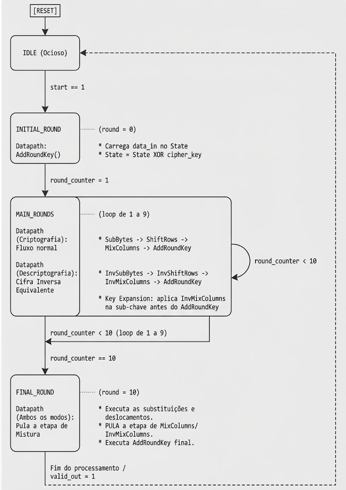

### Relatório de Arquitetura: Sistema de Topo AES-128

Vamos seguir com a AES-128, para ela,o FIPS 197 define parâmetros exatos que simplificam o hardware: o comprimento do bloco de dados ($Nb$) é de 4 palavras (128 bits), o comprimento da chave ($Nk$) é de 4 palavras (128 bits) e o número de rodadas ($Nr$) é estritamente 10.

#### 1. Definição das Interfaces (Inputs e Outputs)

* **data_in [127:0]:** Barramento de entrada de 128 bits. Recebe o texto plano para criptografia ou o texto cifrado para descriptografia. O padrão não permite outros tamanhos de bloco.


* **data_out [127:0]:** Barramento de saída de 128 bits que entrega o resultado final do Estado (State) processado.


* **cipher_key [127:0]:** Barramento da Chave de Cifra, fixado em 128 bits para o AES-128.


* **Sinais de Controle:**
* **clk e rst_n:** Sinais de relógio e reset do sistema.
* **start:** Pulso para iniciar o processamento de um novo bloco.
* **encrypt_decrypt_sel:** Seletor de modo (**1** para cifrar, **0** para decifrar), essencial para controlar o fluxo bidirecional usando a mesma estrutura de dados.
* **valid_out:** Sinal de confirmação de que os dados em **data_out** estão prontos.


#### 2. Projeto do Datapath usando o Pipeline da Cifra Inversa Equivalente

A Cifra Inversa Equivalente permite otimizar a síntese do hardware ao alinhar a ordem das operações de descriptografia com a ordem da criptografia.

* **Estrutura Unificada:** De acordo com o FIPS-197 ordem das transformações InvSubBytes() e InvShiftRows() pode ser invertida na descriptografia, graças à comutatividade dessas operações. Isso permite que o datapath físico use o mesmo fluxo contínuo bidirecional.


* **Fluxo Padrão das Rodadas 1 a 9:** Durante as rodadas intermediárias, o datapath passará pelas operações de (Inv)SubBytes, (Inv)ShiftRows, (Inv)MixColumns e AddRoundKey.


* **Fluxo da Rodada Final (Rodada 10):** A última rodada difere das anteriores pois a transformação de mistura de colunas (MixColumns ou InvMixColumns) não é aplicada. O datapath deve ter um multiplexador para pular (bypass) essa etapa antes do AddRoundKey final.


#### 3. Projeto da FSM e Controle da Key Expansion

Teremos uma Máquina de Estados (FSM) que gerenciará o ciclo fixo de 10 rodadas e controlará como as sub-chaves são injetadas.

* **Contador da FSM:** A FSM iterará com um contador de 0 a 10 ($Nr = 10$).


* No **round = 0**, aplica-se apenas o AddRoundKey inicial.


* De **round = 1** até **round = 9**, o laço completo (com MixColumns) é executado.


* No **round = 10**, a FSM sinaliza para o datapath omitir o MixColumns e encerrar com o AddRoundKey final.


* **Geração de Chaves (Key Expansion):** A rotina de Expansão de Chave gera um total de 44 palavras de 32 bits, o que corresponde a $Nb \times (Nr + 1)$.


* **Modificação de Controle para a Cifra Inversa Equivalente:** Para que o reuso do datapath funcione na descriptografia, a FSM da *Key Expansion* deve realizar um pré-processamento. A ordem das transformações AddRoundKey() e InvMixColumns() pode ser invertida se o cronograma de chaves de descriptografia for modificado.


* **Ajuste das Sub-chaves:** As palavras do cronograma de chaves das rodadas 1 a 9 ($Nr - 1$) devem sofrer a transformação InvMixColumns() antes de serem enviadas para o datapath principal no momento da descriptografia.


* **Exceção do Ajuste:** As primeiras 4 palavras ($Nb$) e as últimas 4 palavras ($Nb$) do cronograma de chaves não devem passar pela modificação InvMixColumns(). A FSM deve garantir essa isenção para a rodada inicial e a rodada final.

## Fluxo da Máquina de Estados (FSM) - AES-128 (Top-Level System)

Abaixo está o diagrama do fluxo da FSM projetada para controlar o datapath do AES-128 e sincronizar a expansão de chaves, focando no reuso de hardware proporcionado pela Cifra Inversa Equivalente.





## Módulos Pertencentes ao Sistema de Topo (AES-128)

Este diagrama ilustra a divisão arquitetural do módulo principal (Top-Level) do AES-128, mostra as interfaces externas e a relação entre os blocos internos de controle e processamento de dados (datapath), otimizados usando a Cifra Inversa Equivalente.

```text
================================================================================
                           AES-128 TOP-LEVEL MODULE
================================================================================

      SINAIS DE CONTROLE                            
                                         
        >>> clk                                       
        >>> rst_n                                    
        >>> start                                     
        >>> encrypt_decrypt_sel                
        <<< ready                              
        <<< valid_out       

    BARRAMENTOS DE DADOS                   

        >>> data_in [127:0]
        >>> cipher_key [127:0]
        <<< data_out [127:0]


--------------------------------------------------------------------------------
                                 ARQUITETURA INTERNA
--------------------------------------------------------------------------------


   ------------------------------------------------------------------------

                            MÁQUINA DE ESTADOS (FSM)                       


        * Controla os ciclos de 0 a 10 rodadas (round_counter).               
        * Define o fluxo direcional (cifrar/decifrar) com base no sinal sel.    
        * Habilita registradores de estado(State).                            
        * OmitE o MixColumns() na Rodada 10.                                  
                                                                          
   ------------------------------------------------------------------------

             |                                              |
      (round_counter)                            (sinais de multiplexação)
      (encrypt_decrypt_sel)                      (pula MixColumns na rodada final)
             |                                              |
             v                                              v
   -------------------------                ------------------------------
                                                                         
        KEY EXPANSION                             DATAPATH (PIPELINE)    
                                                                         
    * Módulo Sequencial                         * Registradores de Estado (State).    
    para gerar as 44 words 
    (11 sub-chaves de 128 bits).     

                                ==============>   
                                  (sub-chave)
                                                * Fluxo Unificado:              
                                                (Inv)SubBytes                 
                                                (Inv)ShiftRows                
    * Para Decifrar: Aplica                     (Inv)MixColumns               
      InvMixColumns() nas                       AddRoundKey                   
      sub-chaves de 1 a 9.                                               
   -------------------------                 ----------------------------
```


## Detalhes sobre o Key Expansion
É importante ressaltar que o AES nunca usa a senha principal diretamente em todas as rodadas, a senha mestre K serve para uma Key expansion que produz um conjunto de sub-chaves chamadas de Round Keys. Cada rodada da criptografia exige pedaços específicos dessas chaves.

O número total de words de 4 bytes geradas é dados por Nb * (Nr + 1). No AES de-128 (NB = 4, Nr = 10), então será preciso produzir 4 * 11 (44) palavras encadeadas

O procedimento usa três funções já citadas

1. **RotWord()** que desloca os 4 bytes de uma palavra ciclicamente para a esquerda

2. **SubWord()** que passa cada um desses bytes pela tabela S-box para disfarcá-los não linearmente

3. **Rcon[]** uma tabeela de constantes baseada em potencias de x (usando o xtime()), inserindo algo de diferente a cada rodada, o que garante que duas etapas nunca usem chaves identicas